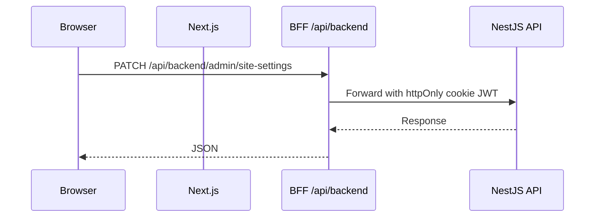

# Architecture

End-to-end context and layer rules. Coding rules: `.cursor/rules/clean-architecture.mdc` (backend), `.cursor/rules/frontend-data.mdc` + `design-system.mdc` (frontend).

## System context

```text
Browser → Next.js (FSD + BFF) → NestJS API → PostgreSQL
                              ↘ Redis (cache / throttle / refresh blacklist)
```

Shared contracts: `@default/types`. Pure helpers: `@default/utils`.

## Backend (`backend/`)

NestJS **Clean Architecture**.

```text
src/
├── domain/              # Entities, repository interfaces (no Nest/ORM)
├── application/         # Use cases, ports, DTOs
├── infrastructure/      # Drizzle, Redis, JWT, migrations, seed
├── presentation/http/   # Controllers, guards, filters, DTOs
└── shared/
```

**Dependency rule:** `presentation` → `application` → `domain` ← `infrastructure`

| Module | Responsibility |
|--------|----------------|
| Auth | Login, refresh, logout, MFA, OIDC |
| User | CRUD, GDPR export/anonymize |
| Authorization | Roles, permissions |
| SiteSetting | Singleton site settings |
| Media | S3-compatible upload |
| Dashboard | Admin stats |
| Audit | Audit log API |

**Persistence:** Drizzle (`infrastructure/database/drizzle/`), migrations in `drizzle/migrations/`. Core tables: users, roles, permissions, refresh_tokens, audit_logs, site_settings, organizations, organization_members.

## Frontend (`frontend/`)

Next.js **Feature-Sliced Design** + **BFF** auth.

```text
@default/types → @default/api → @default/hooks → features|widgets UI
@default/design-tokens → @default/ui → UI
```

i18n: `src/shared/i18n` (app-local). BFF: `app/api/*` + `src/shared/lib/bff-*`.

```text
app/           # App Router (routes, layouts, API routes)
widgets/       # Composed UI (sidebar, marketing sections)
features/      # User interactions (auth, site-settings, MFA)
entities/      # Thin models / entity UI (data hooks in @default/hooks)
shared/        # Config, BFF helpers, i18n
processes/     # Providers, proxy / middleware
```

**Import rule:** upper layers import lower only. Features must not import widgets.

### Request flow (admin)



### Key paths

| Area | Location |
|------|----------|
| Marketing | `app/(marketing)/` |
| Admin | `app/dashboard/` |
| Auth BFF | `app/api/auth/` |
| BFF client IP | `src/shared/lib/bff-client-meta.ts` → `X-Forwarded-For` on upstream Nest calls |
| Proxy allowlist | `src/shared/config/bff-allowlist.ts` |
| Public fetch | `src/entities/public-api/public-server.ts` |

Nest normalizes stored audit/session IPs via `@default/utils/client-ip` (`resolve-client-ip.ts` in presentation).

## Shared decisions

1. **Layered boundaries** — domain has no Nest/ORM; features do not call Nest directly.
2. **Identity** — JWT + refresh; optional MFA/OIDC; RBAC permission codes; audit on mutating admin actions.
3. **White label** — deploy-time env names; runtime `site_settings` for logos, hero, SEO, theme.
4. **Template scope** — auth/admin foundation only; extend after fork.
